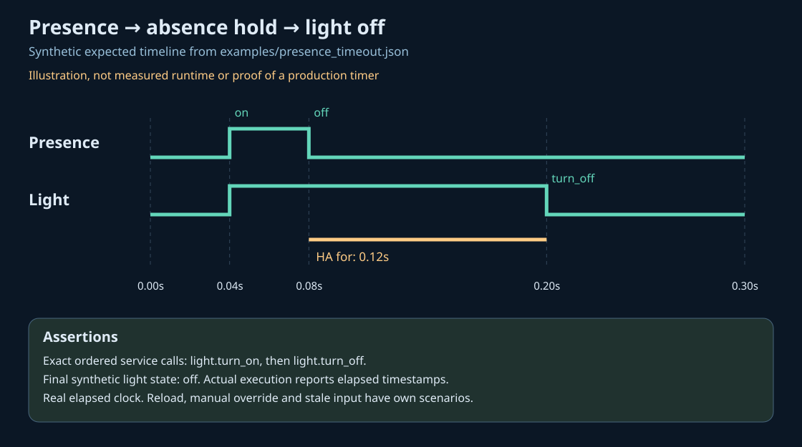

# HA Scenario Tests

[English](README.md) · [Русский](README.ru.md) · [Español](README.es.md)

Begrenzte synthetische Szenarien laufen in der **echten Automations- und Skript-Engine von Home Assistant 2026.10.1**. Geprüft werden die genaue Reihenfolge der Dienstaufrufe, verbotene Aufrufe und Endzustände. Das Programm akzeptiert keine HA-Adresse, Zugangsdaten oder produktive Konfiguration.

Vor dem Einsatz den [Validierungsbericht](docs/validation.md) lesen: Vollständige Laufzeittests sind Voraussetzung für eine Veröffentlichung; ein lokaler nativer Absturz beim Beenden ist dort dokumentiert.

## Installation

Python 3.14.2–3.14.x ist erforderlich. Die Installation lädt Abhängigkeiten herunter; Szenarien benötigen kein Netzwerk.

```sh
python3.14 -m venv .venv
.venv/bin/python -m pip install --require-hashes -r requirements.lock
.venv/bin/python -m pip install --no-deps .
.venv/bin/ha-scenario --lang de validate examples/presence_timeout.json
.venv/bin/ha-scenario --lang de run examples/manual_override.json --report result.json
.venv/bin/python -m pytest -q --junitxml=junit.xml
```

Exitcodes: 0 erfolgreich, 1 fehlgeschlagene Erwartung, 2 Eingabe- oder Laufzeitfehler. Berichte überschreiben keine vorhandenen Dateien. JSON-Schlüssel bleiben sprachunabhängig; Hilfe und Ergebnisse sind übersetzt.

## Umfang

Vier Beispiele prüfen Anwesenheit, manuelle Sperre, Sensorausfall und echtes `automation.reload`. Jeder Lauf erhält einen neuen Python-Prozess und ein temporäres HA-Verzeichnis. Künstliche Aktoren protokollieren Aufrufe und ändern Testzustände. Der Audit-Guard blockiert Netzwerk- und Subprozessoperationen. Er ist keine Betriebssystem-Sandbox; für eine zusätzliche Netzwerkgrenze den Container mit `--network none` starten.

Es gibt keine virtuelle Uhr, keinen Import beliebiger Automationen und keine Hardwareprüfung. Ein 120-ms-Test beweist keinen produktiven 20-Minuten-Timer. Die pytest-Fixture `scenario_runner` gibt einen JSON-kompatiblen Bericht zurück.



Weiterführende Dokumentation: [Installation](docs/install.md), [Szenarioformat](docs/scenarios.md), [Fehlerbehebung](docs/troubleshooting.md), [Grenzen](docs/limits.md), [Wiki](wiki/Home.md). Ausführliche Dokumentation ist auf Englisch und Russisch verfügbar. MIT-Lizenz; sämtliche Beispieldaten sind erfunden.
