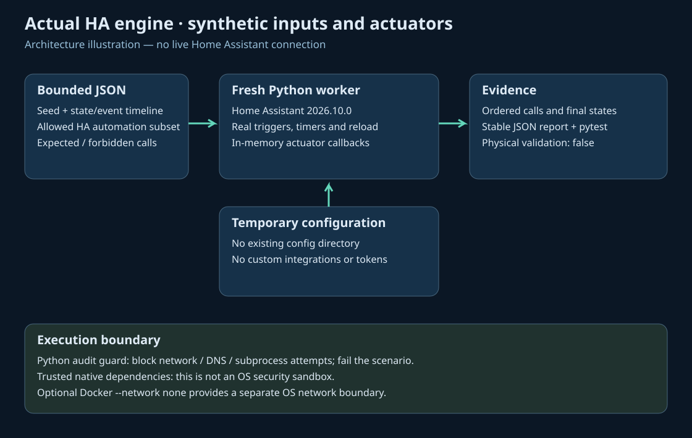

# HA Scenario Tests

[Русский](README.ru.md) · [Deutsch](README.de.md) · [Español](README.es.md)

Run bounded, synthetic household scenarios in the **real Home Assistant 2026.10.0 automation and script engine**. Assert the exact ordered service calls, forbidden calls and final synthetic states. There is no Home Assistant URL, token, device connection or production config input.

This is an early, deliberately restricted test runner. It is not a general YAML importer, physical simulator, hardware acceptance test, or OS security sandbox. Its clock uses real elapsed time; a 120 ms test timeout does **not** validate a production 20 minute timer.

Read the [validation record](docs/validation.md) before adopting it; full runtime checks are release gates, and a local native teardown failure is documented there.


## Install and run

Use Python **3.14.2–3.14.x** in a fresh virtual environment. Installation downloads dependencies; execution does not require network access.

```sh
python3.14 -m venv .venv
.venv/bin/python -m pip install --require-hashes -r requirements.lock
.venv/bin/python -m pip install --no-deps .
.venv/bin/ha-scenario validate examples/presence_timeout.json
.venv/bin/ha-scenario run examples/presence_timeout.json --report result.json
.venv/bin/ha-scenario --lang ru run examples/stale_sensor.json
.venv/bin/python -m pytest -q --junitxml=junit.xml
```

Exit codes: **0** passed/valid, **1** assertion failed, **2** invalid input or runtime failure. `--report` creates a new file and refuses to overwrite an existing one. JSON field names and failure codes are stable across languages. CLI help, validation and result messages support English, Russian, German and Spanish.

## What executes

The seed creates only `*.scenario_*` synthetic entities. Each timeline step waits its `after` seconds, then changes a state, emits a `scenario_*` event, or calls the real `automation.reload` service against the temporary configuration. Real HA state/event triggers, state conditions, `for` timers and action dispatch execute. Registered in-memory actuator callbacks capture service calls and update synthetic states.

Four complete examples cover presence/absence, a manual hold, sensor unavailability during an absence timer, and actual automation reload followed by reconciliation. Exact calls include order and duplicates. `forbidden` assertions provide an additional explicit negative contract.



Each scenario uses a new Python `-I` child and temporary HA directory. It cannot load custom integrations, templates, arbitrary services, URLs or an existing HA configuration through the scenario format. A worker-wide Python audit guard rejects network connection/bind/send/DNS and subprocess operations; any attempt fails the report. Dependencies are trusted code: this guard is **not an OS sandbox** and cannot constrain arbitrary native code. For an OS network boundary, run the supplied container with `--network none`; see [installation](docs/install.md).

## pytest

The installed plugin exposes `scenario_runner`:

```python
from ha_scenario_tests.schema import load

def test_my_policy(scenario_runner):
    result = scenario_runner(load("examples/manual_override.json"))
    assert result["passed"], result
```

The function returns a serializable report; pytest supplies JUnit via `--junitxml`. It never silently skips because HA is missing: installation/runtime mismatch is an error.

## Documentation

- [Installation and containment](docs/install.md) / [RU](docs/install.ru.md)
- [Scenario contract](docs/scenarios.md) / [RU](docs/scenarios.ru.md)
- [Troubleshooting](docs/troubleshooting.md) / [RU](docs/troubleshooting.ru.md)
- [Limits and evidence](docs/limits.md) / [RU](docs/limits.ru.md)
- [Checked-in wiki](wiki/Home.md) / [RU](wiki/Home.ru.md)
- [Contributing](CONTRIBUTING.md), [security](SECURITY.md), [changelog](CHANGELOG.md)

## Relationship to upstream

Home Assistant owns automation semantics. The initial fixture approach was informed by the real-runtime tests in [ha-homelab/home-assistant](https://github.com/ha-homelab/home-assistant/blob/main/tests/test_living_room_presence.py). No household configuration was copied. [pytest-homeassistant-custom-component](https://github.com/MatthewFlamm/pytest-homeassistant-custom-component) provides broader integration-test fixtures; use it when testing a custom integration. [Synthetic Home](https://github.com/allenporter/home-assistant-synthetic-home) provides synthetic home datasets and test tooling. This project adds a small bounded timeline/side-effect contract rather than replacing either project.

MIT licensed. All bundled entities, events, illustrations and reports are synthetic.
